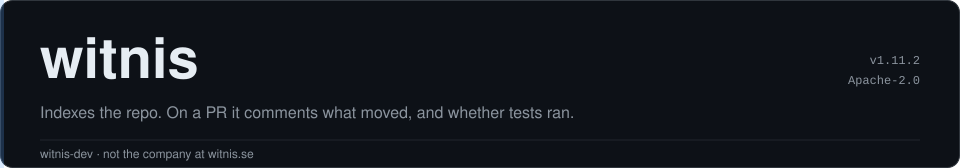
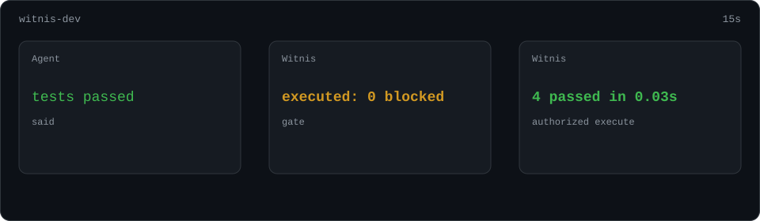

<!-- mcp-name: io.github.L00PLeGeNd/witnis -->
<p align="center">
  
</p>

Verify does nothing until you set `WITNIS_ALLOW_VERIFY=1` and pass `--execute`. `automation_verified` means the commands ran. It is not a human review.

<p align="center">
  
</p>

On spring-petclinic, `git grep -lw Person` stops at five files. `witnis impact Person` follows `Owner extends Person` into the controllers. Measured (grep recall 0, impact 1.0 on those controllers; not LLM A/B): [`docs/benchmarks/petclinic-person-grep-vs-impact.md`](docs/benchmarks/petclinic-person-grep-vs-impact.md).

## Action

History has to be in the checkout (`fetch-depth: 0`):

```yaml
- uses: actions/checkout@v4
  with: { fetch-depth: 0 }
- uses: L00PLeGeNd/Witnis/.github/actions/pr-gate@v1
```

`@v1` moves with 1.x. Pin with `@v1.11.1` if you do not want that. Default CI is blocked / 0 commands.

## MCP

Four tools: `index`, `look`, `impact`, `verify`. The rest is `WITNIS_MCP_EXPERIMENTAL=1`.

```bash
uvx witnis loop-init
```

That writes the Cursor / Claude snippet and a stdio policy. Harnis sits in front of the server; you do not install a second product. `WITNIS_DB` defaults to `.witnis/index.sqlite`.

```json
{
  "mcpServers": {
    "witnis": {
      "command": "npx",
      "args": [
        "-y", "harnis", "mcp", "--preset", "coding-agent", "--",
        "uvx", "witnis", "mcp"
      ]
    }
  }
}
```

<p align="center">
  
</p>

`pip install witnis` / `uvx witnis`. Pin the Action with `@v1.11.1` if you do not want `@v1` to move.

If you are searching: **witnis-dev**. Unrelated to [Witnis AB](https://www.witnis.se). PetClinic labels (18 items, not dual-human): [`docs/benchmarks/petclinic-human-v2.md`](docs/benchmarks/petclinic-human-v2.md). Isolation: [`SECURITY.md`](SECURITY.md). License: Apache-2.0.

mcp-name: io.github.L00PLeGeNd/witnis
