<!-- mcp-name: io.github.L00PLeGeNd/witnis -->

# Witnis

Local evidence for coding agents: index a repo, show blast radius, put the same envelope on a PR, and keep verify **blocked** until you authorize it.

Search name: **witnis-dev**. Not [Witnis AB](https://www.witnis.se). Apache-2.0.

## Install

```bash
pip install witnis
# or
uvx witnis
```

## What it catches that grep misses

On [spring-petclinic](https://github.com/spring-projects/spring-petclinic) @ `500158f`, `git grep -lw Person -- '*.java'` hits five files. None of them are `OwnerController`, `PetController`, or `VisitController` — those only talk about `Owner`.

`witnis impact Person` follows `Owner extends Person` into those controllers.

```bash
witnis index .
witnis impact Person --plain
```

That is analysis completeness (grep vs index), not an LLM A/B test. Dual-human labels are still open. Notes: [`docs/benchmarks/petclinic-person-grep-vs-impact.md`](docs/benchmarks/petclinic-person-grep-vs-impact.md).

<p align="center">
  
</p>

## PR Action

Use a full clone (`fetch-depth: 0`). `@v1` moves with 1.x; pin `@v1.11.2` if you do not want that. Default run is blocked — 0 commands executed.

```yaml
- uses: actions/checkout@v4
  with: { fetch-depth: 0 }
- uses: L00PLeGeNd/Witnis/.github/actions/pr-gate@v1
```

## MCP

Public tools: `index`, `look`, `impact`, `verify`. Everything else needs `WITNIS_MCP_EXPERIMENTAL=1`.

```bash
uvx witnis loop-init
```

That writes a Cursor / Claude snippet and a Harnis stdio policy. One install — seatbelt is not a second product. `WITNIS_DB` defaults to `.witnis/index.sqlite`.

```json
{
  "mcpServers": {
    "witnis": {
      "command": "npx",
      "args": [
        "-y", "harnis", "mcp", "--preset", "coding-agent", "--",
        "uvx", "witnis", "mcp"
      ]
    }
  }
}
```

## Verify honesty

Verify does nothing until `WITNIS_ALLOW_VERIFY=1` and `--execute`. `automation_verified` means the allowlisted commands ran. It is not a human review.

More: [`SECURITY.md`](SECURITY.md) · [`docs/trusted-agent-loop.md`](docs/trusted-agent-loop.md) · [`docs/cli-cheatsheet.md`](docs/cli-cheatsheet.md) · PetClinic GT (not dual-human): [`docs/benchmarks/petclinic-human-v2.md`](docs/benchmarks/petclinic-human-v2.md).

mcp-name: io.github.L00PLeGeNd/witnis
