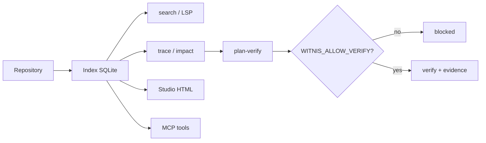

# Witnis

**Engineering witness for AI coding agents.**  
Understand the repo. Trace the blast radius. Verify with evidence — not vibes.

Sibling to [Harnis](https://github.com/L00PLeGeNd/Harnis): *Harness* constrains what an agent may **do**; *Witness* grounds what an agent may **claim**.

[](https://github.com/L00PLeGeNd/Witnis/actions/workflows/ci.yml)
[](LICENSE)
[](https://www.python.org/)
[](docs/rust-migration.md)
[](https://github.com/L00PLeGeNd/Witnis/releases)

---

## The problem

Coding agents can edit files, run tests, and sound confident. They still frequently:

- confuse text hits with **typed symbols**
- miss call / inherit / override edges that define blast radius
- treat “tests passed once” as proof without a **gated** verification story
- return answers with no machine-checkable **evidence status**

Grep and RAG help retrieval. They do not witness claims.

## What Witnis is

Witnis is **local-first verification infrastructure** for agent workflows:

| Capability | What it means |
|---|---|
| **Index** | Symbols & relations into SQLite (no cloud required) |
| **Evidence envelopes** | Every answer carries `status`, `evidence`, `limitations` |
| **Impact** | Bound change blast radius and related tests |
| **Gated verify** | Execution blocked unless `--execute` + `WITNIS_ALLOW_VERIFY=1` |
| **One Core, many adapters** | Same contracts over **CLI · MCP · SDK · Studio** |

Core facts do **not** require an LLM.



---

## Quick start

```bash
git clone https://github.com/L00PLeGeNd/Witnis.git
cd Witnis
pip install -e ".[dev,lsp]"

python -m witnis index fixtures/mini_py
python -m witnis search login --json
python -m witnis trace login --json
python -m witnis impact login --json
python -m witnis lsp AuthService --json
python -m witnis plan-verify --target login
python -m witnis studio --target login --out .witnis/studio.html

pytest -q
python -m witnis bench --suite public
```

Optional extras:

```bash
pip install -e ".[lsp]"    # Jedi enrichment
pip install -e ".[rust]"   # maturin helper for native builds
pip install -e ".[all]"
```

---

## Agent loop (recommended)

A practical witness loop for Cursor / Claude / other MCP agents:

1. **Index** the repo once (or refresh after large edits)
2. **Search** for the symbol the agent claims to change
3. **Trace** callers / inheritance / decorators
4. **Impact** + related tests before editing
5. **plan-verify** → only then **verify --execute** with explicit auth
6. **Studio** / evidence bundle for human review

Playbook: [`examples/agent-playbook.md`](examples/agent-playbook.md)

### Evidence envelope (shape)

Every Core/MCP/CLI JSON payload includes:

```json
{
  "status": "success",
  "repository": { "name": "mini_py", "root_path": "..." },
  "result": {},
  "evidence": [
    { "type": "symbol", "status": "observed", "path": "auth.py", "line": 12, "name": "AuthService.login" }
  ],
  "limitations": ["Search is name/path FTS+LIKE match, not semantic embedding"],
  "generated_at": "2026-11-03T12:00:00Z"
}
```

Evidence statuses are the uncertainty model: `observed` · `derived` · `verified` · `unverified` · `contradicted` · `stale` · …

Full contracts: [`docs/contracts-v1.md`](docs/contracts-v1.md)

---

## What you get

| Layer | Surface |
|---|---|
| **CLI** | `index`, `refresh`, `overview`, `status`, `search`, `trace`, `impact`, `evidence`, `plan-verify`, `verify`, `studio`, `lsp`, `bench`, `compare-baselines`, `capabilities`, … |
| **MCP** | `repo_search`, `trace_symbol`, `analyze_impact`, `run_verification`, `query_lsp`, `render_studio`, `list_capabilities`, … |
| **SDK** | `from witnis.sdk import index_repository, repo_search, trace_symbol, …` |
| **Studio** | Static HTML dashboard (graph / evidence / report), locales `en\|zh\|pt\|fr\|ru` |
| **Languages** | Python (deep AST) · JS/TS · Go · Java (shallow) |
| **LSP** | Jedi definitions/refs · index fallback · optional Pyright diagnostics |

### vs baselines

| Approach | Typed symbols | Call/impact graph | Evidence statuses | Gated verify |
|---|---|---|---|---|
| `git grep` / naive scan | no | no | no | no |
| Naive `def/class` regex | shallow | no | no | no |
| **Witnis** | yes | yes | yes | yes |

Run the comparison yourself:

```bash
python -m witnis compare-baselines fixtures/mini_py --out docs/benchmarks/local-v1.md
```

---

## Cursor MCP

```json
{
  "mcpServers": {
    "witnis": {
      "command": "python",
      "args": ["-m", "witnis", "mcp", "--db", "/ABS/PATH/TO/Witnis/.witnis/index.sqlite"],
      "env": {
        "WITNIS_DB": "/ABS/PATH/TO/Witnis/.witnis/index.sqlite"
      }
    }
  }
}
```

Example config: [`examples/mcp.cursor.example.json`](examples/mcp.cursor.example.json)

Index first, then point `WITNIS_DB` at the SQLite file. Agents should call `list_capabilities` before assuming tool names.

---

## Security defaults

Witnis is **read-only by default**.

- Path sandbox + symlink escape checks
- Sensitive filenames (`.env`, `*.pem`, `*.key`, …) skipped or flagged
- Secret-like values redacted in previews
- Verification blocked unless explicitly authorized
- Repo text treated as **untrusted** (prompt-injection aware)

Details: [`SECURITY.md`](SECURITY.md)

---

## Benchmarks

Public acceptance suite (must stay green in CI):

```bash
python -m witnis bench --suite local
python -m witnis bench --suite public
```

| Suite | Fixture focus |
|---|---|
| Local | `fixtures/mini_py` regression tasks |
| Public | `mini_py` + Go/JS/Java smokes + polyglot `fixtures/public_svc` |

Current scoreboard: **21 / 21** on public (v1.8.0).  
Methodology: [`docs/benchmarks/PUBLIC.md`](docs/benchmarks/PUBLIC.md) · History: [`docs/benchmarks/public-scoreboard.md`](docs/benchmarks/public-scoreboard.md)

---

## Architecture

```
adapters:  CLI (Typer) · MCP · SDK · Studio HTML
    │
core:      index · search · trace · impact · verify · evidence · LSP
    │
native:    optional witnis._native (PyO3) → witnis-core (Rust)
    │
store:     SQLite + FTS5 symbols / relations / snapshots
```

- **Python-first adapters** stay installable with plain `pip`
- **Rust** accelerates discover, digests, RustPython AST, SQLite index/search
- Missing native module ⇒ Python implementations keep working

### Rust core (optional)

```bash
cargo test -p witnis-core
cargo run -p witnis-cli -- discover fixtures/mini_py
cargo run -p witnis-cli -- index fixtures/mini_go --db .witnis/rust-go.sqlite --full
cargo run -p witnis-cli -- search Login --db .witnis/rust-go.sqlite
cargo run -p witnis-cli -- overview --db .witnis/rust-go.sqlite

maturin build -m crates/witnis-py/Cargo.toml --release --out dist-native
pip install dist-native/witnis-*.whl
```

Env knobs:

| Variable | Effect |
|---|---|
| `WITNIS_RUST_INDEX=1` | Force Rust indexer |
| `WITNIS_RUST_INDEX=auto` | Rust indexer when `_native` is loaded |
| (default) | Rust for non-`.py` trees; Python AST for `.py` |
| `WITNIS_ALLOW_VERIFY=1` | Allow `verify --execute` |

Migration notes: [`docs/rust-migration.md`](docs/rust-migration.md)

---

## Docs map

| Doc | Purpose |
|---|---|
| [`docs/contracts-v1.md`](docs/contracts-v1.md) | Stable CLI/MCP/envelope contracts |
| [`docs/rust-migration.md`](docs/rust-migration.md) | Gradual Rust phases |
| [`docs/benchmarks/PUBLIC.md`](docs/benchmarks/PUBLIC.md) | Public bench methodology |
| [`SECURITY.md`](SECURITY.md) | Security defaults |
| [`CONTRIBUTING.md`](CONTRIBUTING.md) | Dev loop + PR rules |
| [`CHANGELOG.md`](CHANGELOG.md) | Release history |
| [`examples/agent-playbook.md`](examples/agent-playbook.md) | Agent usage playbook |

---

## Status

**Usable today** for local Python-first agent workflows:

`index → search / trace / impact → gated verify → Studio / MCP`

Still deepening: unified Rust `witnis` binary, stronger language-server backends, larger third-party corpora.

Latest release: [v1.8.0](https://github.com/L00PLeGeNd/Witnis/releases/tag/v1.8.0)

---

## Contributing

See [`CONTRIBUTING.md`](CONTRIBUTING.md). Please keep `pytest` and `witnis bench --suite public` green.

## License

Apache-2.0 — see [`LICENSE`](LICENSE).
