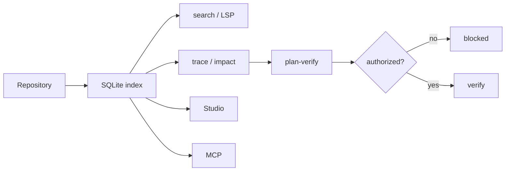

# Witnis

**An engineering witness for AI coding agents.**

Map the repo. Trace the blast radius. Verify with evidence — not vibes.

Witnis pairs with [Harnis](https://github.com/L00PLeGeNd/Harnis): the *harness* limits what an agent can **do**; the *witness* grounds what an agent can **claim**.

[](https://github.com/L00PLeGeNd/Witnis/actions/workflows/ci.yml)
[](LICENSE)
[](https://www.python.org/)
[](docs/rust-migration.md)
[](https://github.com/L00PLeGeNd/Witnis/releases)

---

## Why it exists

Agents can edit files, run tests, and sound sure of themselves. They still often:

- treat a text hit as a **typed symbol**
- miss call, inherit, and override edges that define real blast radius
- equate “tests passed once” with proof — without a **gated** verify path
- answer without a machine-checkable **evidence status**

Grep and RAG find strings. They do not witness claims.

Witnis is local-first: index the tree into SQLite, answer through shared contracts, and keep Core facts free of any LLM.

| Piece | Role |
|---|---|
| **Index** | Symbols and relations on disk — no cloud |
| **Evidence envelope** | Every reply carries `status`, `evidence`, `limitations` |
| **Impact** | Callers, related tests, change radius |
| **Gated verify** | Runs only with `--execute` and `WITNIS_ALLOW_VERIFY=1` |
| **One Core** | Same behavior on **CLI · MCP · SDK · Studio** |



---

## Quick start

```bash
git clone https://github.com/L00PLeGeNd/Witnis.git
cd Witnis
pip install -e ".[dev,lsp]"

witnis demo                 # index sample + witness card
witnis index .              # or index your own repo
witnis look login           # search · trace · impact · tests · plan
witnis studio login --open  # HTML dashboard
```

Deeper cuts when you need them:

```bash
witnis search login
witnis trace login --plain
witnis plan login
witnis verify login          # blocked until authorized
WITNIS_ALLOW_VERIFY=1 witnis verify login --execute
witnis bench --suite public
```

Extras: `.[lsp]` (Jedi), `.[rust]` (maturin), or `.[all]`.

---

## How agents should use it

```text
witnis index .
witnis look <symbol>
witnis plan <symbol>
WITNIS_ALLOW_VERIFY=1 witnis verify <symbol> --execute
witnis studio <symbol> --open
```

`look` is the short path: one card instead of four separate JSON dumps.  
Playbook: [`examples/agent-playbook.md`](examples/agent-playbook.md)

### Envelope shape

CLI, MCP, and SDK share the same JSON shape:

```json
{
  "status": "success",
  "repository": { "name": "mini_py", "root_path": "..." },
  "result": {},
  "evidence": [
    {
      "type": "symbol",
      "status": "observed",
      "path": "auth.py",
      "line": 12,
      "name": "AuthService.login"
    }
  ],
  "limitations": ["Search is name/path FTS+LIKE, not embeddings"],
  "generated_at": "2026-11-03T12:00:00Z"
}
```

Statuses encode uncertainty: `observed` · `derived` · `verified` · `unverified` · `contradicted` · `stale` · …

Contracts: [`docs/contracts-v1.md`](docs/contracts-v1.md)

---

## Surfaces

| Layer | What you get |
|---|---|
| **CLI** | `demo`, `look`, `index`, `search`, `trace`, `impact`, `plan`, `verify`, `studio`, `lsp`, `bench`, … |
| **MCP** | `repo_search`, `trace_symbol`, `analyze_impact`, `run_verification`, `query_lsp`, `render_studio`, … |
| **SDK** | `from witnis.sdk import index_repository, repo_search, trace_symbol, …` |
| **Studio** | Static HTML (graph / evidence / report), `en` `zh` `pt` `fr` `ru` |
| **Languages** | Python (AST) · JS/TS · Go · Java (**shallow** — not full semantic) |
| **LSP** | Jedi · index fallback · optional Pyright diagnostics |

Language depth and known gaps (Spring DI, dual-engine parity, …): [`docs/DEPTH.md`](docs/DEPTH.md).

### Against simple baselines

| Approach | Typed symbols | Call / impact | Evidence | Gated verify |
|---|---|---|---|---|
| `git grep` / naive scan | — | — | — | — |
| Regex `def` / `class` | shallow | — | — | — |
| **Witnis** | yes (fixture-proven) | yes (name/AST-level; not full semantic) | yes | yes (authorize gate, not OS sandbox) |

```bash
witnis baselines fixtures/mini_py
```

---

## MCP (any compatible client)

Same Core over MCP for any compatible host or coding agent. Index the repo, then register the server:

```json
{
  "mcpServers": {
    "witnis": {
      "command": "witnis",
      "args": ["mcp"],
      "env": {
        "WITNIS_DB": "/ABS/PATH/TO/repo/.witnis/index.sqlite"
      }
    }
  }
}
```

Sample: [`examples/mcp.example.json`](examples/mcp.example.json)

Clients differ in config file layout; the important bits are the `witnis mcp` command and `WITNIS_DB`. Agents should call `list_capabilities` before assuming tool names.

---

## Security posture

Read-only by default.

- Paths sandboxed to the indexed root (symlink escapes rejected)
- Sensitive names (`.env`, `*.pem`, `*.key`, …) skipped or flagged
- Secret-like values redacted in previews
- Verify stays blocked until you authorize it (**gate ≠ sandbox** — see [`SECURITY.md`](SECURITY.md))
- Repo prose is untrusted input (prompt-injection aware)

More: [`SECURITY.md`](SECURITY.md)

---

## Benchmarks

CI keeps the public **acceptance** suite green:

```bash
witnis bench --suite local
witnis bench --suite public
```

| Suite | Scope |
|---|---|
| Local | `fixtures/mini_py` regressions |
| Public | `mini_py` + Go / JS / Java smokes + polyglot `fixtures/public_svc` |
| Ground truth | Scaffold only — [`benchmarks/ground-truth/`](benchmarks/ground-truth/) |

Public score (package **1.8.1**): **21 / 21** acceptance checks.  
That score is **not** a claim of 100% semantic accuracy on real large repos.  
Method: [`docs/benchmarks/PUBLIC.md`](docs/benchmarks/PUBLIC.md) · History: [`docs/benchmarks/public-scoreboard.md`](docs/benchmarks/public-scoreboard.md) · Honesty: [`docs/DEPTH.md`](docs/DEPTH.md)

---

## Layout

```
adapters   CLI · MCP · SDK · Studio
    │
core       index · search · trace · impact · verify · evidence · LSP
    │
native     optional witnis._native (PyO3) → witnis-core (Rust)
    │
store      SQLite + FTS5 (symbols, relations, snapshots)
```

Python adapters install with plain `pip`. Rust speeds discover, digests, RustPython AST, and SQLite index/search. If `_native` is missing, Python paths still work.

### Optional Rust tools

```bash
cargo test -p witnis-core
cargo run -p witnis-cli -- discover fixtures/mini_py
cargo run -p witnis-cli -- index fixtures/mini_go --db .witnis/rust-go.sqlite --full
cargo run -p witnis-cli -- search Login --db .witnis/rust-go.sqlite
cargo run -p witnis-cli -- overview --db .witnis/rust-go.sqlite

maturin build -m crates/witnis-py/Cargo.toml --release --out dist-native
pip install dist-native/witnis-*.whl
```

| Env | Meaning |
|---|---|
| `WITNIS_RUST_INDEX=1` | Always use the Rust indexer |
| `WITNIS_RUST_INDEX=auto` | Rust indexer when `_native` is loaded |
| *(default)* | Rust for non-`.py` trees; Python AST for `.py` |
| `WITNIS_ALLOW_VERIFY=1` | Allow `verify --execute` |

See [`docs/rust-migration.md`](docs/rust-migration.md).

---

## Docs

| Doc | Contents |
|---|---|
| [`docs/contracts-v1.md`](docs/contracts-v1.md) | Stable CLI / MCP / envelope |
| [`docs/rust-migration.md`](docs/rust-migration.md) | Rust migration phases |
| [`docs/benchmarks/PUBLIC.md`](docs/benchmarks/PUBLIC.md) | Public bench method |
| [`SECURITY.md`](SECURITY.md) | Security defaults (gate ≠ sandbox) |
| [`docs/DEPTH.md`](docs/DEPTH.md) | Honest depth status & next bets |
| [`CONTRIBUTING.md`](CONTRIBUTING.md) | Dev loop and PR expectations |
| [`CHANGELOG.md`](CHANGELOG.md) | Releases |
| [`examples/agent-playbook.md`](examples/agent-playbook.md) | Agent usage |

---

## Status

Ready for local Python-first agent work:

**index → search / trace / impact → gated verify → Studio / MCP**

Still ahead: real-repo ground truth (P/R, false-pass rate), deeper four-language semantics, verify isolation, Python/Rust parity as a merge gate, then a single Rust `witnis` binary.

Package / crates: **1.8.1**. Latest tagged release on GitHub may lag until a release cut — see [`CHANGELOG.md`](CHANGELOG.md).

---

## Contributing

See [`CONTRIBUTING.md`](CONTRIBUTING.md). Keep `pytest` and `witnis bench --suite public` green.

## License

Apache-2.0 — [`LICENSE`](LICENSE).
